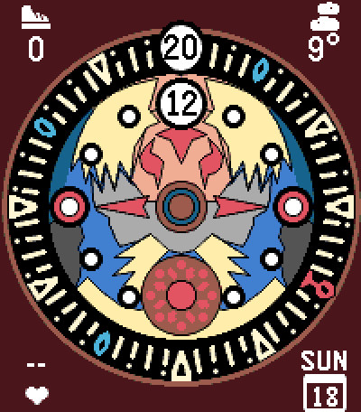
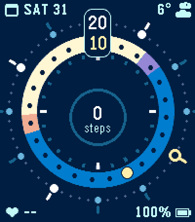

# Pebble watch faces

Watch faces for the Pebble Time 2 (emery). Each face is its own Pebble
project in its own folder.

| [Clock Town Clock](clocktown-clock/) | [Tellura](tellura/) |
| :---: | :---: |
|  |  |
| Inspired by the Clock Tower clock from The Legend of Zelda: Majora's Mask | Two turning rings for minutes and hours, the hour ring coloured by day, night, dawn and dusk |

## Build and install

Requires the [Pebble SDK](https://developer.repebble.com/sdk) and Node.js.
Run from the face's folder, e.g.:

```bash
cd tellura
npm install
pebble build
pebble install --emulator emery     # or --phone <IP> for your watch
```

## Repository layout

- `clocktown-clock/`, `tellura/`: one Pebble project per watch face
- `design/`: HTML mockups used while designing the faces
- `.agents/skills/pebble-watchface/`: agent skill for building Pebble watch
  faces (linked from `.claude/skills/`)

Releases are tagged per face, e.g. `tellura-v1.0.0`.

## License

The watch face code is released under the [MIT License](LICENSE). The
following parts keep their own terms:

- `.agents/skills/pebble-watchface/`: the
  [pebble-watchface agent skill](https://github.com/coredevices/pebble-watchface-agent-skill)
  by Core Devices
- `*/resources/images/weather_*.png`: derived from the Pebble timeline weather
  icons
