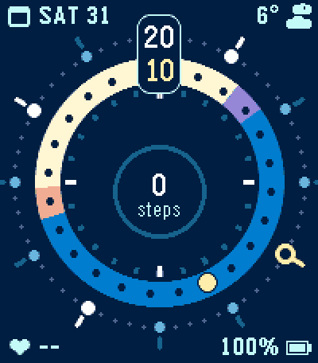
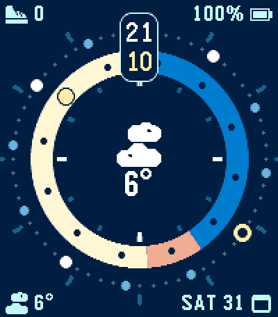
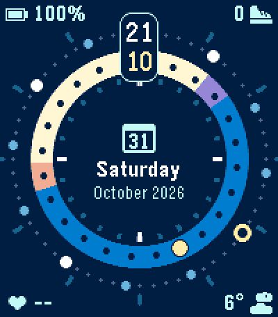
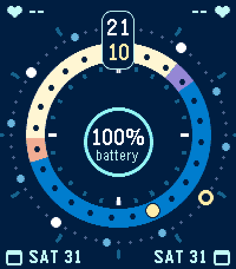

# Tellura

Pebble Time 2 watch face with two turning rings: an outer ring for the minutes
and an inner ring for the hours, coloured like the sky by day, night, dawn and
dusk. The four corners and the centre are configurable to display the date,
weather, steps, heart rate or battery.

| Default | Weather in the centre, 12-hour ring |
| :---: | :---: |
|  |  |
| **Date in the centre** | **Battery in the centre** |
|  |  |

## How to read it

Both rings turn clockwise. Each ring's top position indicates the current minute and
hour, also shown as digits in the box across both rings. At the same time the
yellow marks work like the hands of a classic clock: the circle on the minute
ring is the minute hand, the dot on the hour ring the hour hand.

The hour ring shows the coming day: cream by day, blue by night, purple at dawn
and apricot at dusk, from the sunrise and sunset times for your location.
Counter-clockwise from the top you see what is ahead, e.g. how long until
sunset. In 12-hour mode the ring shows the next 12 hours.

The tick marks around the outside stay in place. Every 5 minutes the 0 and
15-minute dots line up with them and light them up. The hour tick nearest the
hour hand grows as the hand approaches and turns yellow within 15 minutes of
it.

## Settings

Open the watch face's settings in the Pebble app to change:

- **12-hour hour ring**: off by default (the ring shows the whole day)
- **12-hour digital time**: off by default (24-hour)
- **Tick marks**: minute and hour tick marks, each on by default
- **Metrics**: weather, date, steps, heart rate, battery or nothing, for the
  centre and each corner

## Build and install

Requires the [Pebble SDK](https://developer.repebble.com/sdk) and Node.js.
Run from this folder:

```bash
npm install
pebble build
pebble install --emulator emery     # or --phone <IP> for your watch
```

Only the emery platform (Pebble Time 2) is supported.

## Data sources

- Weather, sunrise and sunset come from [Open-Meteo](https://open-meteo.com)
  (no API key needed), fetched by the phone every 30 minutes using your
  location.
- Steps and heart rate come from Pebble Health on the watch.
- The weather icons are the official Pebble timeline weather icons, converted
  by `tools/weather_icons.py`.

## License

The watch face code is released under the [MIT License](../LICENSE).
`resources/images/weather_*.png` are derived from the Pebble timeline weather
icons and keep their own terms.
